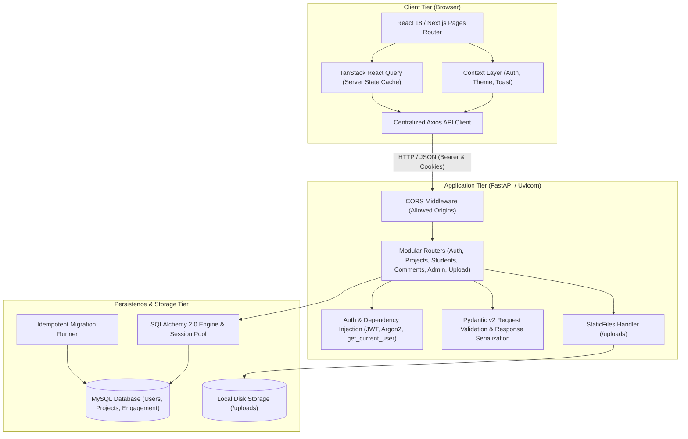
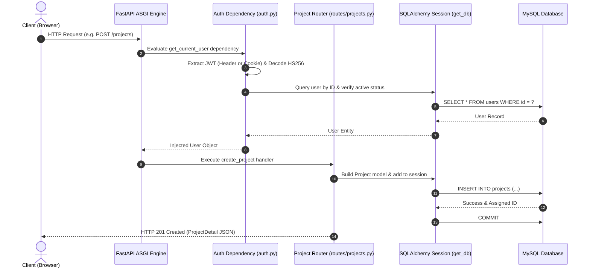

# ProjectHub Architecture & System Design

This document details the architectural design, communication protocols, state management, and security boundaries implemented in **ProjectHub (Student Project Showcase)**.

---

## 1. High-Level Architecture Overview

ProjectHub follows a decoupled, client-server web architecture:
- **Presentation Layer**: Next.js 14 (Pages Router) application rendered in React 18 and styled with Tailwind CSS. It communicates with the backend exclusively via asynchronous RESTful HTTP calls.
- **Application & API Layer**: FastAPI (Python 3.11) ASGI application providing modular route controllers, dependency injection for authentication and database sessions, and input validation schemas via Pydantic v2.
- **Persistence Layer**: MySQL relational database accessed via SQLAlchemy 2.0 ORM using connection pooling and the PyMySQL driver.

---

## 2. Frontend Architecture (Next.js)

### State Management Separation
1. **Server State (TanStack React Query)**:
   - Manages asynchronous remote data: project catalogs, detailed project views, comment threads, categories, and student profiles.
   - Provides background re-fetching, configurable stale time (`staleTime: 3 minutes`), and mutation cache invalidation upon project edits, likes, favorites, and comments.
2. **Client State (React Context)**:
   - `AuthContext`: Manages current user identity, authentication status (`isAuthenticated`, `isAdmin`), token storage, and session lifecycle (`login`, `register`, `logout`).
   - `ThemeContext`: Handles light/dark mode preference, syncs with `localStorage`, and toggles the `dark` class on the root HTML element.
   - `ToastContext`: Provides global toast notifications for action confirmations and error handling.

### Centralized Service Layer (`frontend/services/api.ts`)
All network interactions pass through a configured Axios instance:
- Automatically injects the JWT token as an `Authorization: Bearer <token>` header when present in local storage.
- Enables `withCredentials: true` to support HTTP-only session cookies.
- Normalizes backend error messages (`error.response.data.detail`) into standard JavaScript exceptions.

---

## 3. Backend Architecture (FastAPI)

### Request Lifecycle

### Dependency Injection Pipeline
FastAPI dependencies are utilized for clean separation of concerns:
- `get_db`: Yields an isolated SQLAlchemy session per request and guarantees session closure in a `finally` block.
- `get_current_user`: Validates token claims, raises standard HTTP 401 on expiration or invalidity, and retrieves the active user entity.
- `get_optional_current_user`: Non-blocking authentication resolver that returns `None` for anonymous guests, enabling contextual personalization (e.g. whether the current viewer liked a project).
- `get_current_admin`: Asserts `user.role == "admin"`, raising HTTP 403 Forbidden for unauthorized requests.

---

## 4. Security Architecture

1. **Password Security**:
   - Uses **Argon2** (`argon2-cffi`), the winner of the Password Hashing Competition (PHC), providing memory-hard and time-cost protections against brute-force and GPU-based dictionary attacks.
   - Plaintext passwords are never logged and never included in database query outputs or Pydantic serialization models.
2. **Dual-Token Authentication**:
   - The backend signs JWT tokens with HMAC-SHA256 containing a `sub` user identifier and an expiration timestamp (`exp`).
   - Tokens can be transmitted via:
     - Standard HTTP `Authorization: Bearer <token>` header.
     - HTTP-only `access_token` cookie configured with `SameSite=Lax` and `Path=/`.
3. **Authorization & Resource Ownership**:
   - Update and delete operations strictly verify that `db_project.user_id == current_user.id` or `current_user.role == "admin"`.
   - The `is_featured` flag is protected; regular users cannot feature their own projects.
4. **Input Sanitization & Injection Defense**:
   - All database operations are compiled through SQLAlchemy parameterized queries, preventing SQL injection.
   - Pydantic models validate input types, string lengths, and email formats before reaching business logic.
   - File uploads are validated against a strict MIME/extension whitelist (`.jpg`, `.jpeg`, `.png`, `.webp`, `.gif`), capped at 5MB, and given randomized UUID filenames to eliminate path traversal vulnerabilities.
