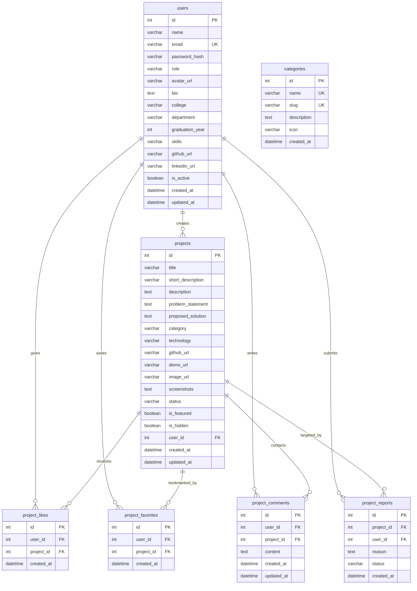

# Database Design & Schema Specification

This document details the relational database design, table definitions, foreign key constraints, indexes, and migration strategy for **ProjectHub (Student Project Showcase)** on MySQL.

---

## 1. Entity-Relationship Diagram (ERD)

---

## 2. Table Specifications

### 2.1 `users`
Stores student and administrator account information and portfolio metadata.

| Column | Data Type | Nullable | Default | Description |
| :--- | :--- | :--- | :--- | :--- |
| `id` | `INT` | No | Auto Increment | Primary Key |
| `name` | `VARCHAR(255)` | No | None | Full display name |
| `email` | `VARCHAR(255)` | No | None | Unique email address (indexed) |
| `password_hash`| `VARCHAR(255)` | No | None | Argon2 password hash string |
| `role` | `VARCHAR(50)` | No | `'student'` | Access role (`'student'`, `'admin'`) |
| `avatar_url` | `VARCHAR(500)` | Yes | `NULL` | Static path or remote URL to avatar |
| `bio` | `TEXT` | Yes | `NULL` | Short biography and academic intro |
| `college` | `VARCHAR(255)` | Yes | `NULL` | University or academic institution |
| `department` | `VARCHAR(255)` | Yes | `NULL` | Department or major |
| `graduation_year`| `INT` | Yes | `NULL` | Expected or past graduation year |
| `skills` | `VARCHAR(500)` | Yes | `NULL` | Comma-separated list of technical skills |
| `github_url` | `VARCHAR(255)` | Yes | `NULL` | GitHub profile link |
| `linkedin_url` | `VARCHAR(255)` | Yes | `NULL` | LinkedIn profile link |
| `is_active` | `BOOLEAN` | No | `TRUE` | Account status flag |
| `created_at` | `DATETIME` | No | `UTC_TIMESTAMP`| Registration timestamp |
| `updated_at` | `DATETIME` | No | `UTC_TIMESTAMP`| Last update timestamp |

---

### 2.2 `projects`
Stores student project submissions, problem/solution documentation, and status.

| Column | Data Type | Nullable | Default | Description |
| :--- | :--- | :--- | :--- | :--- |
| `id` | `INT` | No | Auto Increment | Primary Key |
| `title` | `VARCHAR(255)` | No | None | Project title (indexed) |
| `short_description`| `VARCHAR(500)`| Yes | `NULL` | Tagline for cards and search snippets |
| `description` | `TEXT` | Yes | `NULL` | Full documentation & implementation |
| `problem_statement`| `TEXT` | Yes | `NULL` | Detailed engineering problem addressed |
| `proposed_solution`| `TEXT` | Yes | `NULL` | Technical solution and architecture |
| `category` | `VARCHAR(100)` | Yes | `NULL` | Discipline name (indexed) |
| `technology` | `VARCHAR(255)` | Yes | `NULL` | Comma-separated tech stack tags |
| `github_url` | `VARCHAR(255)` | Yes | `NULL` | GitHub source code URL |
| `demo_url` | `VARCHAR(255)` | Yes | `NULL` | Live deployed application URL |
| `image_url` | `VARCHAR(500)` | Yes | `NULL` | Static path or URL to cover banner |
| `screenshots` | `TEXT` | Yes | `NULL` | JSON array of screenshot URLs |
| `status` | `VARCHAR(50)` | No | `'published'` | Publication state (`'draft'`, `'published'`) |
| `is_featured` | `BOOLEAN` | No | `FALSE` | Featured showcase flag (indexed) |
| `is_hidden` | `BOOLEAN` | No | `FALSE` | Admin moderation hide flag (indexed) |
| `user_id` | `INT` | No | None | Foreign key referencing `users.id` |
| `created_at` | `DATETIME` | No | `UTC_TIMESTAMP`| Submission timestamp (indexed) |
| `updated_at` | `DATETIME` | No | `UTC_TIMESTAMP`| Last edit timestamp |

---

### 2.3 `project_likes`
Records unique student likes on projects.

| Column | Data Type | Nullable | Default | Description |
| :--- | :--- | :--- | :--- | :--- |
| `id` | `INT` | No | Auto Increment | Primary Key |
| `user_id` | `INT` | No | None | Foreign key referencing `users.id` (CASCADE) |
| `project_id` | `INT` | No | None | Foreign key referencing `projects.id` (CASCADE) |
| `created_at` | `DATETIME` | No | `UTC_TIMESTAMP`| Interaction timestamp |

**Unique Constraint**: `UNIQUE KEY uq_user_project_like (user_id, project_id)`

---

### 2.4 `project_favorites`
Records student bookmarking and favorite collections.

| Column | Data Type | Nullable | Default | Description |
| :--- | :--- | :--- | :--- | :--- |
| `id` | `INT` | No | Auto Increment | Primary Key |
| `user_id` | `INT` | No | None | Foreign key referencing `users.id` (CASCADE) |
| `project_id` | `INT` | No | None | Foreign key referencing `projects.id` (CASCADE) |
| `created_at` | `DATETIME` | No | `UTC_TIMESTAMP`| Interaction timestamp |

**Unique Constraint**: `UNIQUE KEY uq_user_project_favorite (user_id, project_id)`

---

### 2.5 `project_comments`
Stores discussion comments and peer reviews on projects.

| Column | Data Type | Nullable | Default | Description |
| :--- | :--- | :--- | :--- | :--- |
| `id` | `INT` | No | Auto Increment | Primary Key |
| `user_id` | `INT` | No | None | Foreign key referencing `users.id` (CASCADE) |
| `project_id` | `INT` | No | None | Foreign key referencing `projects.id` (CASCADE) |
| `content` | `TEXT` | No | None | Comment body |
| `created_at` | `DATETIME` | No | `UTC_TIMESTAMP`| Created timestamp |
| `updated_at` | `DATETIME` | No | `UTC_TIMESTAMP`| Updated timestamp |

---

### 2.6 `categories`
Stores standardized technical disciplines.

| Column | Data Type | Nullable | Default | Description |
| :--- | :--- | :--- | :--- | :--- |
| `id` | `INT` | No | Auto Increment | Primary Key |
| `name` | `VARCHAR(100)` | No | None | Category display name (Unique) |
| `slug` | `VARCHAR(100)` | No | None | URL slug identifier (Unique, indexed) |
| `description` | `TEXT` | Yes | `NULL` | Category explanation |
| `icon` | `VARCHAR(100)` | Yes | `NULL` | Lucide icon identifier |
| `created_at` | `DATETIME` | No | `UTC_TIMESTAMP`| Creation timestamp |

---

### 2.7 `project_reports`
Stores moderation reports submitted by students against inappropriate or violating projects.

| Column | Data Type | Nullable | Default | Description |
| :--- | :--- | :--- | :--- | :--- |
| `id` | `INT` | No | Auto Increment | Primary Key |
| `project_id` | `INT` | No | None | Foreign key referencing `projects.id` (CASCADE) |
| `user_id` | `INT` | No | None | Foreign key referencing `users.id` (CASCADE) |
| `reason` | `TEXT` | No | None | Report explanation |
| `status` | `VARCHAR(50)` | No | `'pending'` | Review status (`'pending'`, `'reviewed'`, `'dismissed'`) |
| `created_at` | `DATETIME` | No | `UTC_TIMESTAMP`| Report timestamp |

---

## 3. Migration Runner (`backend/app/migrate.py`)

The application incorporates an automated idempotent schema migration runner that executes upon server boot:
1. **Reflection**: Uses SQLAlchemy's `inspect(engine)` to reflect existing tables and existing columns.
2. **Column Additions**: Checks whether added columns (`role`, `avatar_url`, `short_description`, `problem_statement`, `proposed_solution`, etc.) exist in `users` and `projects`. If missing, executes `ALTER TABLE ... ADD COLUMN ...` statements safely without data loss.
3. **Table Creation**: Calls `Base.metadata.create_all()` for any missing engagement tables.
4. **Seed Execution**:
   - Seeds standard disciplines if `categories` is empty.
   - Promotes the user matching `ADMIN_EMAIL` to the `admin` role if configured.
